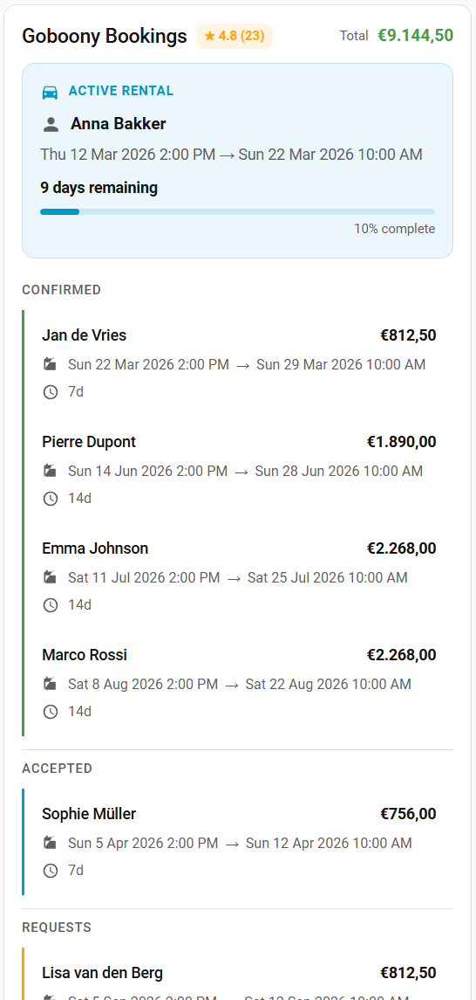
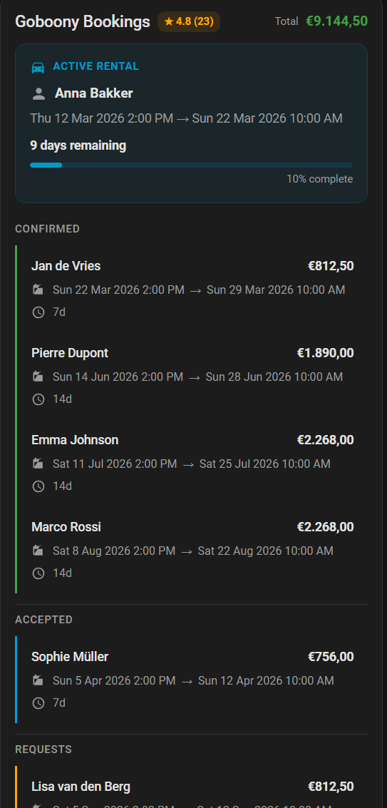

## Doel

_English version: see [English](#english) at the bottom._

Custom integratie voor Home Assistant (HACS) voor eigenaars die een camper of mobilhome verhuren via Goboony. Ze leest je Goboony-account en zet boekingen, een boekingskalender en bijhorende sensoren in Home Assistant, zodat je komende verhuringen ziet en ze kan gebruiken in dashboards en automaties.

- **Voor:** eigenaars die een camper verhuren op Goboony en Home Assistant gebruiken.
- **Installeren:** zoek "Goboony" in HACS, installeer, herstart Home Assistant en voeg de integratie toe via Instellingen, Apparaten en diensten.
- **Inbegrepen:** een Lovelace-boekingskaart (`goboony-bookings-card.js`).

## Status
- **Fase:** release (stabiel, dagelijks in gebruik).
- **Huidige versie:** 2.0.0

<p align="center">
  
</p>

<p align="center">
  <a href="https://github.com/hacs/integration"></a>
  <a href="https://github.com/aaamoeder/ha-goboony/releases"></a>
  <a href="https://opensource.org/licenses/MIT"></a>
</p>

<p align="center">
  Een alles-in-een pakket voor Home Assistant voor eigenaars die hun camper of mobilhome verhuren via <a href="https://www.goboony.com">Goboony</a>.<br>
  Met een <strong>custom integratie</strong> (sensoren, kalender, binaire sensoren, diagnose) en een <strong>custom Lovelace-kaart</strong> met visuele editor.<br>
  Volg je boekingen, inkomsten, beschikbaarheid, tarieven en reviews rechtstreeks in je slimme woning.
</p>

---

<p align="center">
  <em>Heeft dit project je geholpen? Trakteer me dan gerust op een koffie</em> ☕
</p>

<p align="center">
  <a href="https://buymeacoffee.com/aaamoeder">
    
  </a>
</p>

---

## Functies

| Functie | Beschrijving |
|---------|--------------|
| **Overzicht boekingen** | Aantal boekingen in totaal, bevestigd, in aanvraag en wachtend op betaling |
| **Volgende boeking** | Details van de volgende boeking met aftelling |
| **Aftelling check-in** | Uren tot de volgende check-in |
| **Inkomsten** | Totale inkomsten van bevestigde boekingen |
| **Tarieven** | Standaard-, hoog- en laagseizoenstarief, prijs per extra kilometer en waarborg |
| **Beschikbaarheid** | Aantal geboekte, geblokkeerde en vrije dagen |
| **Bezettingsgraad** | Geboekte dagen als percentage van geboekte plus vrije dagen |
| **Geblokkeerde periodes** | Periodes die je zelf blokkeerde (vakantie, onderhoud, ...) |
| **Reviews en score** | Gemiddelde score en aantal reviews van je advertentie |
| **Nu verhuurd** | Binaire sensor: AAN als de camper nu verhuurd is |
| **Open aanvragen** | Binaire sensor: AAN als er boekingsaanvragen op antwoord wachten |
| **Komende boeking** | Binaire sensor: AAN als er een boeking in de toekomst is |
| **Wissel** | Binaire sensor: AAN tussen een check-out en de volgende check-in |
| **Handmatig vernieuwen** | Knop om meteen nieuwe gegevens op te halen |
| **Foto advertentie** | Afbeeldingsentiteit met de hoofdfoto van je advertentie |
| **Kalender** | Gewone HA-kalender met alle boekingen en geblokkeerde periodes |
| **Eigen kaart** | Volledig instelbare boekingskaart met visuele editor |
| **Diagnose** | Download diagnosegegevens vanaf de integratiepagina |

## Installatie

### HACS (aanbevolen)

[](https://my.home-assistant.io/redirect/hacs_repository/?owner=aaamoeder&repository=ha-goboony&category=integration)

1. Open **HACS** in Home Assistant
2. Zoek **Goboony** in de HACS-winkel
3. Klik op **Download**
4. **Herstart** Home Assistant

> Sinds v1.7.5 beschikbaar in de standaardwinkel van HACS.

### Handmatig installeren

1. Download de [laatste release](https://github.com/aaamoeder/ha-goboony/releases/latest)
2. Kopieer de map `custom_components/goboony` naar je map `config/custom_components/`
3. Herstart Home Assistant

## Instellen

1. Ga naar **Instellingen** > **Apparaten en diensten** > **Integratie toevoegen**
2. Zoek **Goboony**
3. Vul je gegevens in:

| Naam | Type | Verplicht | Beschrijving |
|------|------|-----------|--------------|
| `email` | tekst | ja | Het e-mailadres van je Goboony-eigenaarsaccount |
| `password` | tekst | ja | Je Goboony-wachtwoord |
| `listing_id` | tekst | ja | Het ID van je camper uit de URL van je camperpagina (bv. `goboony.com/campers/12345`). Een oud Goboony-advertentie-ID werkt ook. |

> De integratie ondersteunt **opnieuw aanmelden**: werken je gegevens niet meer, dan vraagt Home Assistant ze opnieuw.

### Opties

Ga na het instellen naar **Instellingen** > **Apparaten en diensten** > **Goboony** > **Configureren** om dit te wijzigen:

| Naam | Type | Verplicht | Standaard | Sinds | Beschrijving |
|------|------|-----------|-----------|-------|--------------|
| `scan_interval` | getal | nee | `60` | v1.0.0 | Hoe vaak gegevens opgehaald worden (minuten, van 15 tot 1440) |

## Entiteiten

### Sensoren

| Sensor | Beschrijving | Eenheid | Categorie |
|--------|--------------|---------|-----------|
| Totaal boekingen | Aantal boekingen | - | - |
| Bevestigde boekingen | Aantal bevestigde (betaalde) boekingen | - | - |
| Volgende boeking | Datums van de volgende bevestigde boeking | - | - |
| Dagen tot volgende boeking | Aftelling tot de volgende boeking | dagen | - |
| Aftellen check-in | Uren tot de volgende check-in | uren | - |
| Totale inkomsten | Som van de inkomsten van bevestigde boekingen | EUR | - |
| Bezettingsgraad | Geboekte dagen als percentage | % | - |
| Beoordelingen | Score van de advertentie (bv. 5.0) met het aantal reviews | - | - |
| Basistarief | Standaard dagtarief (hoog- en laagseizoenstarief, prijs per extra kilometer en waarborg als attributen) | EUR | Diagnose |
| Piektarief | Hoogste seizoenstarief per dag | EUR | Diagnose |
| Geboekte dagen | Geboekte dagen in de komende 365 dagen | dagen | - |
| Geblokkeerde dagen | Zelf geblokkeerde dagen in de komende 365 dagen | dagen | - |
| Beschikbare dagen | Vrije dagen in de komende 365 dagen | dagen | - |
| Geblokkeerde periodes | Aantal geblokkeerde periodes | - | Diagnose |

### Binaire sensoren

| Sensor | Beschrijving |
|--------|--------------|
| Momenteel verhuurd | AAN als de camper nu verhuurd is |
| Openstaande aanvragen | AAN als er boekingsaanvragen op jouw antwoord wachten |
| Aankomende boeking | AAN als er een bevestigde boeking in de toekomst is |
| Wisseldag | AAN tussen een check-out en de volgende check-in |

### Andere entiteiten

| Entiteit | Type | Beschrijving |
|----------|------|--------------|
| Gegevens vernieuwen | Knop | Haalt meteen nieuwe gegevens op |
| Advertentiefoto | Afbeelding | Hoofdfoto van je Goboony-advertentie |
| Boekingskalender | Kalender | Alle boekingen en geblokkeerde periodes |

## Lovelace-kaart

De integratie bevat een eigen boekingskaart die **automatisch geregistreerd** wordt. Je hoeft geen resource met de hand toe te voegen.

<p align="center">
  
  &nbsp;&nbsp;
  
</p>

### De kaart toevoegen

1. Bewerk je dashboard
2. Klik op **Kaart toevoegen**
3. Zoek **Goboony Bookings**
4. Stel ze in met de visuele editor

### Wat de kaart toont

- Balk voor de lopende verhuur met voortgang en aftelling
- Aantal vrije dagen tussen boekingen
- Herkenning van wisseldagen (check-out op dezelfde dag als de volgende check-in)
- Klikbare boekingen die naar de detailpagina op Goboony gaan
- Relatieve datums ("in 3d", "tomorrow", ...)
- Score van de reviews in de kop
- Filter op status (bevestigd, wacht op betaling, aanvragen)
- Inkomsten per boeking en in totaal in de kop
- Compacte weergave voor een dichtere lijst
- Volledig opgemaakt met de CSS-variabelen van HA, werkt met elk thema (licht, donker, eigen)
- Visuele editor

### Opties van de kaart

De visuele editor is ingedeeld in inklapbare secties. De labels in de kaart zelf zijn Engels.

#### Entiteit

| Naam | Type | Verplicht | Standaard | Sinds | Beschrijving |
|------|------|-----------|-----------|-------|--------------|
| `entity` | tekst | ja | - | v1.0.0 | De sensor Totaal boekingen van Goboony |
| `review_entity` | tekst | nee | - | v1.5.0 | De sensor Beoordelingen van Goboony |

#### Kop

| Naam | Type | Verplicht | Standaard | Sinds | Beschrijving |
|------|------|-----------|-----------|-------|--------------|
| `title` | tekst | nee | `Goboony Bookings` | v1.0.0 | Eigen titel |
| `show_header_icon` | ja/nee | nee | `true` | v1.7.0 | Het camper-icoon in de kop tonen of verbergen |
| `show_total_earnings` | ja/nee | nee | `true` | v1.7.0 | De totale inkomsten in de kop tonen of verbergen |
| `show_review` | ja/nee | nee | `true` | v1.7.0 | De score met ster tonen of verbergen |

#### Lopende verhuur

| Naam | Type | Verplicht | Standaard | Sinds | Beschrijving |
|------|------|-----------|-----------|-------|--------------|
| `show_active_rental` | ja/nee | nee | `true` | v1.7.0 | Het blok met de lopende verhuur tonen of verbergen |
| `show_progress_bar` | ja/nee | nee | `true` | v1.7.0 | De voortgangsbalk van de verhuur tonen of verbergen |

#### Boekingen

| Naam | Type | Verplicht | Standaard | Sinds | Beschrijving |
|------|------|-----------|-----------|-------|--------------|
| `show_earnings` | ja/nee | nee | `true` | v1.7.0 | Inkomsten per boeking tonen of verbergen |
| `show_days` | ja/nee | nee | `true` | v1.7.0 | Duur van de verhuur tonen of verbergen |
| `show_booking_number` | ja/nee | nee | `true` | v1.7.0 | Het boekingsnummer (#12345) tonen of verbergen |
| `show_checkout_date` | ja/nee | nee | `true` | v1.7.0 | De check-out-datum tonen of verbergen |
| `show_relative_date` | ja/nee | nee | `true` | v1.7.0 | Relatieve datums (bv. "in 3d") tonen of verbergen |
| `show_gap_indicators` | ja/nee | nee | `true` | v1.7.0 | Vrije dagen en wisseldagen tussen boekingen tonen of verbergen |
| `show_upcoming` | ja/nee | nee | `true` | v1.8.0 | De sectie Upcoming tonen of verbergen (bevestigde boekingen die nog niet voorbij zijn) |
| `show_past` | ja/nee | nee | `true` | v1.8.0 | De sectie Past tonen of verbergen (bevestigde boekingen die voor vandaag eindigden) |
| `max_past_bookings` | getal | nee | `0` | v1.8.0 | Maximaal aantal voorbije boekingen, meest recente eerst (0 = alle) |
| `max_bookings` | getal | nee | `0` | v1.7.0 | Maximaal aantal getoonde boekingen (0 = alle) |
| `compact_mode` | ja/nee | nee | `false` | v1.7.0 | Compacte weergave op een regel |

#### Filters

| Naam | Type | Verplicht | Standaard | Sinds | Beschrijving |
|------|------|-----------|-----------|-------|--------------|
| `show_statuses` | lijst | nee | alle | v1.6.0 | Welke statussen getoond worden (confirmed, awaiting_payment, request) |

#### Uiterlijk

| Naam | Type | Verplicht | Standaard | Sinds | Beschrijving |
|------|------|-----------|-----------|-------|--------------|
| `show_section_labels` | ja/nee | nee | `true` | v1.7.0 | Sectiekoppen tonen of verbergen (Upcoming, Requests, ...) |
| `show_last_updated` | ja/nee | nee | `true` | v1.7.0 | De voettekst "Updated X min ago" tonen of verbergen |

### Voorbeeld in YAML

```yaml
type: custom:goboony-bookings-card
entity: sensor.goboony_68972_total_bookings
review_entity: sensor.goboony_68972_reviews
title: Mijn camperboekingen
show_statuses:
  - confirmed
  - awaiting_payment
  - request
show_header_icon: true
show_total_earnings: true
show_review: true
show_active_rental: true
show_progress_bar: true
show_earnings: true
show_days: true
show_booking_number: true
show_checkout_date: true
show_relative_date: true
show_gap_indicators: true
show_upcoming: true
show_past: true
max_past_bookings: 0
show_section_labels: true
show_last_updated: true
max_bookings: 0
compact_mode: false
```

## Kalender

De integratie maakt een gewone **kalenderentiteit** in Home Assistant met:
- Bevestigde boekingen met de naam van de huurder en het uur van check-in en check-out
- Boekingen die enkel in de Goboony-kalender staan (zoals boekingen van de oude Goboony-site)
- Periodes die je zelf blokkeerde

Dit werkt met alle kalenderkaarten en automaties in Home Assistant.

## Diagnose

Ga naar **Instellingen** > **Apparaten en diensten** > **Goboony** > **drie puntjes** > **Diagnose downloaden** voor een bestand met diagnosegegevens. Je inloggegevens worden daarin automatisch weggelaten.

## Hoe het werkt

Goboony heeft geen publieke API. Sinds november 2026 draait Goboony op het platform van Yescapa, en de website haalt je gegevens op via een JSON-API. Deze integratie gebruikt dezelfde API met je eigenaarsaccount.

- **Ophaalinterval**: instelbaar, standaard 60 minuten (van 15 tot 1440 minuten)
- **Robuust ophalen**: mislukt een poging, dan probeert de integratie elke 2 minuten opnieuw en houdt ze de vorige gegevens (tot 3 mislukkingen na elkaar)
- **Aanmelden**: meldt aan met je e-mailadres en wachtwoord, en meldt opnieuw aan kort voor het toegangstoken verloopt (elke 3 uur)
- **Gegevens**: boekingen als eigenaar, kalenderperiodes, seizoensprijzen, prijsdetails en je campers

### Overstappen van 1.x

Versie 2.0.0 is nodig sinds Goboony naar het platform van Yescapa verhuisde; 1.x kan niet meer inloggen. Je bestaande entiteiten blijven werken: een oud Goboony-advertentie-ID wordt automatisch omgezet naar het nieuwe camper-ID. Boekingen van de oude Goboony-site zijn niet meeverhuisd, dus het aantal boekingen en de inkomsten beginnen opnieuw bij de boekingen op het nieuwe platform. Oude boekingen die nog in de kalender staan, tellen mee als geboekte dagen.

## Talen

De integratie is vertaald in alle talen van de markten van Goboony:

| Taal | Status |
|------|--------|
| English | Volledig vertaald |
| Nederlands | Volledig vertaald |
| Deutsch | Volledig vertaald |
| Fran&ccedil;ais | Volledig vertaald |
| Italiano | Volledig vertaald |

## Problemen oplossen

| Probleem | Oplossing |
|----------|-----------|
| Integratie laadt niet | Wis de cache van je browser en herstart HA |
| Aanmelden mislukt | Controleer je gegevens en meld opnieuw aan via **Instellingen > Integraties** |
| Geen boekingen te zien | Controleer of het ID van je camper klopt |
| Kaart verschijnt niet | Controleer of de integratie geladen is en zoek "Goboony Bookings" bij het toevoegen van een kaart |
| Onbetaalde boekingen niet te zien | Vink "Awaiting payment" aan in de instellingen van de kaart en wis de cache van je browser |
| Sensoren tonen "onbekend" | Wacht op de eerste ophaalbeurt (tot 60 minuten) of druk op de knop Gegevens vernieuwen |

## Disclaimer

Deze integratie is **niet verbonden aan of goedgekeurd door Goboony**. Ze gebruikt de private API van de Goboony-website en kan dus stoppen met werken als Goboony die wijzigt. Gebruik op eigen risico.

## Licentie

[MIT-licentie](LICENSE): zie het bestand LICENSE voor de details.

---

## English

### Purpose
Home Assistant custom integration (HACS) for Goboony camper and motorhome rental owners. It reads your Goboony account and exposes bookings, a booking calendar and related sensors in Home Assistant, so you can see upcoming rentals and use them in dashboards and automations.

- **For:** owners who rent out a camper on Goboony and run Home Assistant.
- **Install:** add this repository as a custom repository in HACS, install "Goboony", restart Home Assistant and add the integration under Settings, Devices & services.
- **Includes:** a Lovelace bookings card (`goboony-bookings-card.js`).

### Status
- **Phase:** release (stable, in daily use).
- **Current version:** 2.0.0

### Features

| Feature | Description |
|---------|-------------|
| **Bookings overview** | Total, confirmed, pending and awaiting payment counts |
| **Next booking** | Upcoming booking details with countdown |
| **Check-in countdown** | Hours until next check-in |
| **Earnings tracking** | Total earnings of confirmed bookings |
| **Rate monitoring** | Default, high and low season rates, mileage price and deposit |
| **Calendar availability** | Booked, blocked and available day counts |
| **Occupancy rate** | Percentage of booked vs available days |
| **Blocked periods** | Named blocked periods (holidays, maintenance, etc.) |
| **Reviews & rating** | Listing rating and review count |
| **Currently rented** | Binary sensor: ON when camper is rented out |
| **Pending requests** | Binary sensor: ON when there are open booking requests |
| **Upcoming booking** | Binary sensor: ON when a future booking exists |
| **Turnaround** | Binary sensor: ON between check-out and next check-in |
| **Manual refresh** | Button entity to trigger an immediate data update |
| **Listing photo** | Image entity showing your listing's main photo |
| **Calendar entity** | Native HA calendar with all bookings and blocked periods |
| **Custom card** | Fully configurable bookings card with visual editor |
| **Diagnostics** | Download debug data from the integration page |

### Installation

#### HACS (Recommended)

[](https://my.home-assistant.io/redirect/hacs_repository/?owner=aaamoeder&repository=ha-goboony&category=integration)

1. Open **HACS** in your Home Assistant instance
2. Search for **Goboony** in the HACS store
3. Click **Download**
4. **Restart** Home Assistant

> Available in the default HACS store since v1.7.5.

#### Manual installation

1. Download the [latest release](https://github.com/aaamoeder/ha-goboony/releases/latest)
2. Copy the `custom_components/goboony` folder to your `config/custom_components/` directory
3. Restart Home Assistant

### Configuration

1. Go to **Settings** > **Devices & Services** > **Add Integration**
2. Search for **Goboony**
3. Enter your credentials:

| Name | Type | Required | Description |
|------|------|----------|-------------|
| `email` | string | yes | Your Goboony owner account email |
| `password` | string | yes | Your Goboony password |
| `listing_id` | string | yes | Your camper ID from the URL of your camper page (e.g. `goboony.com/campers/12345`). An old Goboony listing ID also works. |

> The integration supports **re-authentication** — if your session expires, Home Assistant will prompt you to re-enter your credentials.

#### Options

After setup, go to **Settings** > **Devices & Services** > **Goboony** > **Configure** to change:

| Name | Type | Required | Default | Since | Description |
|------|------|----------|---------|-------|-------------|
| `scan_interval` | number | no | `60` | v1.0.0 | How often to fetch data from Goboony (minutes, range: 15–1440) |

### Entities

#### Sensors

| Sensor | Description | Unit | Category |
|--------|-------------|------|----------|
| Total bookings | Number of all bookings | — | — |
| Confirmed bookings | Number of confirmed (paid) bookings | — | — |
| Next booking | Dates of the next confirmed booking | — | — |
| Days until next booking | Countdown to next booking | days | — |
| Check-in countdown | Hours until next check-in | hours | — |
| Total earnings | Sum of confirmed booking earnings | EUR | — |
| Occupancy rate | Booked days as percentage of total | % | — |
| Reviews | Listing rating (e.g. 5.0) with review count | — | — |
| Base rate | Default daily rate (high and low season rates, mileage price and deposit as attributes) | EUR | Diagnostic |
| Peak rate | Highest season daily rate | EUR | Diagnostic |
| Booked days | Booked days in the coming 365 days | days | — |
| Blocked days | Owner-blocked days in the coming 365 days | days | — |
| Available days | Available days in the coming 365 days | days | — |
| Blocked periods | Number of blocked periods | — | Diagnostic |

#### Binary sensors

| Sensor | Description |
|--------|-------------|
| Currently rented | ON when the camper is currently rented out |
| Pending requests | ON when there are booking requests waiting for your answer |
| Upcoming booking | ON when there is a future confirmed booking |
| Turnaround | ON between a check-out and the next check-in |

#### Other entities

| Entity | Type | Description |
|--------|------|-------------|
| Refresh data | Button | Trigger an immediate data refresh |
| Listing photo | Image | Main photo from your Goboony listing |
| Bookings calendar | Calendar | All bookings and blocked periods |

### Custom Lovelace card

The integration includes a custom bookings card that is **automatically registered** — no manual resource setup needed.

<p align="center">
  
  &nbsp;&nbsp;
  
</p>

#### Adding the card

1. Edit your dashboard
2. Click **Add Card**
3. Search for **Goboony Bookings**
4. Configure via the visual editor

#### Card features

- Active rental banner with progress bar and countdown
- Gap indicators between bookings showing days between rentals
- Changeover day detection (when check-out = next check-in)
- Clickable bookings linking to Goboony detail page
- Relative date badges ("in 3d", "tomorrow", etc.)
- Review rating display in header
- Status filtering (confirmed, awaiting payment, requests)
- Earnings per booking and total earnings in header
- Compact mode for a denser layout
- Fully themed using HA CSS variables — works with all themes (light, dark, custom)
- Visual editor

#### Card options

The visual editor is organized in collapsible sections:

##### Entity

| Name | Type | Required | Default | Since | Description |
|------|------|----------|---------|-------|-------------|
| `entity` | string | yes | — | v1.0.0 | The Goboony total bookings sensor entity |
| `review_entity` | string | no | — | v1.5.0 | The Goboony reviews sensor entity |

##### Header

| Name | Type | Required | Default | Since | Description |
|------|------|----------|---------|-------|-------------|
| `title` | string | no | `Goboony Bookings` | v1.0.0 | Custom title text |
| `show_header_icon` | boolean | no | `true` | v1.7.0 | Show/hide the camper icon in the header |
| `show_total_earnings` | boolean | no | `true` | v1.7.0 | Show/hide total earnings in the header |
| `show_review` | boolean | no | `true` | v1.7.0 | Show/hide the star rating badge |

##### Active rental

| Name | Type | Required | Default | Since | Description |
|------|------|----------|---------|-------|-------------|
| `show_active_rental` | boolean | no | `true` | v1.7.0 | Show/hide the active rental section |
| `show_progress_bar` | boolean | no | `true` | v1.7.0 | Show/hide the rental progress bar |

##### Bookings

| Name | Type | Required | Default | Since | Description |
|------|------|----------|---------|-------|-------------|
| `show_earnings` | boolean | no | `true` | v1.7.0 | Show/hide earnings on each booking |
| `show_days` | boolean | no | `true` | v1.7.0 | Show/hide rental duration |
| `show_booking_number` | boolean | no | `true` | v1.7.0 | Show/hide the booking reference (#12345) |
| `show_checkout_date` | boolean | no | `true` | v1.7.0 | Show/hide the check-out date |
| `show_relative_date` | boolean | no | `true` | v1.7.0 | Show/hide relative date badges (e.g. "in 3d") |
| `show_gap_indicators` | boolean | no | `true` | v1.7.0 | Show/hide gap days and changeover indicators |
| `show_upcoming` | boolean | no | `true` | v1.8.0 | Show/hide the Upcoming section (confirmed bookings that have not ended yet) |
| `show_past` | boolean | no | `true` | v1.8.0 | Show/hide the Past section (confirmed bookings that ended before today) |
| `max_past_bookings` | number | no | `0` | v1.8.0 | Limit the number of past bookings shown, most recent first (0 = all) |
| `max_bookings` | number | no | `0` | v1.7.0 | Limit the number of bookings shown (0 = all) |
| `compact_mode` | boolean | no | `false` | v1.7.0 | Use a compact single-line layout |

##### Filters

| Name | Type | Required | Default | Since | Description |
|------|------|----------|---------|-------|-------------|
| `show_statuses` | list | no | all | v1.6.0 | Which booking statuses to display (confirmed, awaiting_payment, request) |

##### Appearance

| Name | Type | Required | Default | Since | Description |
|------|------|----------|---------|-------|-------------|
| `show_section_labels` | boolean | no | `true` | v1.7.0 | Show/hide section labels (Confirmed, Requests, etc.) |
| `show_last_updated` | boolean | no | `true` | v1.7.0 | Show/hide the "Updated X min ago" footer |

#### YAML example

```yaml
type: custom:goboony-bookings-card
entity: sensor.goboony_68972_total_bookings
review_entity: sensor.goboony_68972_reviews
title: My Camper Bookings
show_statuses:
  - confirmed
  - awaiting_payment
  - request
show_header_icon: true
show_total_earnings: true
show_review: true
show_active_rental: true
show_progress_bar: true
show_earnings: true
show_days: true
show_booking_number: true
show_checkout_date: true
show_relative_date: true
show_gap_indicators: true
show_upcoming: true
show_past: true
max_past_bookings: 0
show_section_labels: true
show_last_updated: true
max_bookings: 0
compact_mode: false
```

### Calendar

The integration creates a native Home Assistant **calendar entity** showing:
- Confirmed bookings with renter name and check-in and check-out time
- Bookings that are only on the Goboony calendar (such as bookings made on the old Goboony site)
- Owner-blocked periods

This works with all calendar cards and automations in Home Assistant.

### Diagnostics

Go to **Settings** > **Devices & Services** > **Goboony** > **three dots** > **Download diagnostics** to get a debug data file. Credentials are automatically redacted.

### How it works

Goboony does not provide a public API. Since November 2026 Goboony runs on the Yescapa platform, and its website reads your data from a JSON API. This integration uses the same API with your owner account.

- **Polling interval**: configurable, default 60 minutes (range: 15 to 1440 minutes)
- **Resilient fetching**: on failure, retries every 2 minutes while keeping previous data (up to 3 consecutive failures)
- **Authentication**: logs in with your email and password and logs in again shortly before the access token expires (every 3 hours)
- **Data sources**: owner bookings, calendar periods, season prices, price details and your camper listing

#### Upgrading from 1.x

Version 2.0.0 is needed since Goboony moved to the Yescapa platform; 1.x can no longer log in. Your existing entities keep working: an old Goboony listing ID is mapped to the new camper ID automatically. Bookings from the old Goboony site were not moved to the new platform, so the booking counts and earnings start again from the bookings on the new platform. Old bookings that are still on the calendar count as booked days.

### Supported languages

The integration UI is translated into all Goboony market languages:

| Language | Status |
|----------|--------|
| English | Fully translated |
| Nederlands | Fully translated |
| Deutsch | Fully translated |
| Fran&ccedil;ais | Fully translated |
| Italiano | Fully translated |

### Troubleshooting

| Issue | Solution |
|-------|----------|
| Integration not loading | Clear browser cache and restart HA |
| Authentication failed | Check credentials, re-authenticate via **Settings > Integrations** |
| No bookings shown | Verify your listing ID is correct |
| Card not appearing | Make sure the integration is loaded, then search for "Goboony Bookings" when adding a card |
| Unpaid bookings not showing | Make sure "Awaiting payment" is checked in card settings, and clear browser cache |
| Sensors showing "unknown" | Wait for the first data fetch (up to 60 min) or press the Refresh button |

### Disclaimer

This integration is **not affiliated with or endorsed by Goboony**. It uses the private API of the Goboony website, which means it may break if Goboony changes it. Use at your own risk.

### License

[MIT License](LICENSE) — see LICENSE file for details.
